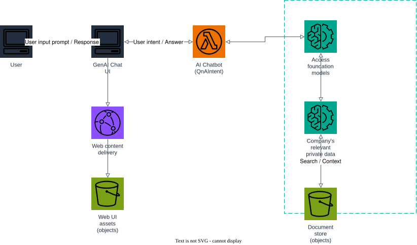

# AWS Project: Self-Service Digital Assistant

This architecture uses Retrieval Augmented Generation (RAG) and generative AI to create a digital assistant for rich, self-service, conversational customer experiences.

1. a user opens the GenAI Chat UI, delivered through CloudFront (web content delivery) from S3 (web UI assets);
2. the chat UI sends the user's input prompt to the AI Chatbot (`QnAIntent` Lambda function);
3. the chatbot resolves the user's intent by calling Bedrock's `RetrieveAndGenerate` API to access foundation models;
4. Bedrock searches the company's relevant private data — a knowledge base backed by an OpenSearch Serverless vector index over documents in the document store (S3) — and generates a grounded answer, which flows back to the user.

## Prerequisites

- Docker
- Terraform 1.5+
- AWS CLI

## Start Floci

```bash
docker compose up -d
```

## Apply Terraform

```bash
terraform init
terraform apply
```

Applying:

- creates the OpenSearch Serverless vector collection and the Bedrock knowledge base over the `document-store` S3 bucket;
- deploys the `ai-chatbot` Lambda (with a public Function URL) that calls `bedrock-agent-runtime.retrieve_and_generate`;
- renders [web/index.html.tftpl](web/index.html.tftpl) with the chatbot's Function URL and uploads it to the `web-ui-assets` bucket, served through CloudFront.

## Architecture



The diagram source is a real, editable [draw.io](https://www.drawio.com/) file at [docs/architecture.drawio](docs/architecture.drawio), generated programmatically with the [drawpyo](https://github.com/MerrimanInd/drawpyo) Python library. Open the `.drawio` file directly on GitHub or with the draw.io desktop app / [app.diagrams.net](https://app.diagrams.net/) to edit it.

To regenerate the diagram (`.drawio` source + the `.svg`/`.png` embedded above) after changing the architecture:

```bash
python3 -m venv .diagram-venv
.diagram-venv/bin/pip install drawpyo
.diagram-venv/bin/python scripts/generate_diagram.py

# rasterize the .drawio file to svg/png (used by the README) via headless draw.io
docker run --rm -v "$PWD/docs":/data -w /data rlespinasse/drawio-export -f svg -o . --output-mode relative --remove-page-suffix .
docker run --rm -v "$PWD/docs":/data -w /data rlespinasse/drawio-export -f png -o . --output-mode relative --remove-page-suffix -t .
```

## Load documents into the knowledge base

Upload a few company documents, then trigger ingestion so the knowledge base can search them:

```bash
DOC_BUCKET=$(terraform output -raw document_store_bucket)
KB_ID=$(terraform output -raw knowledge_base_id)

aws --endpoint-url http://localhost:4566 s3 cp ./faq.txt "s3://$DOC_BUCKET/faq.txt"

aws --endpoint-url http://localhost:4566 bedrock-agent start-ingestion-job \
  --knowledge-base-id "$KB_ID" --data-source-id "$(terraform output -raw document_store_bucket)"
```

## Chat with the assistant

```bash
CHATBOT_URL=$(terraform output -raw chatbot_function_url)

curl -s -X POST "$CHATBOT_URL" \
  -H "Content-Type: application/json" \
  -d '{"prompt": "What is our refund policy?"}' | jq
```

## Open the web app

```bash
open "https://$(terraform output -raw cloudfront_domain_name)"
```

If you want to follow the execution, watch the Floci container logs:

```bash
docker compose logs -f floci
```

## Clean up

```bash
terraform destroy
docker compose down
```
